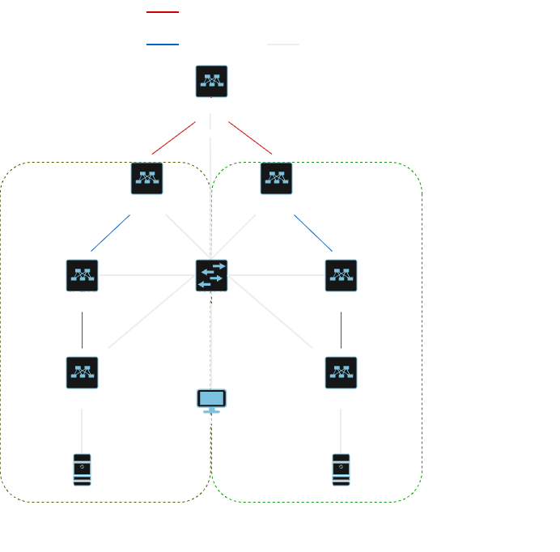

# automated-multi-site-evpn-vxlan
Automatisoitu multi-tenant multi-site VXLAN fabric -konesaliverkon toteutus Ciscon Nexus 9000v -virtuaalikytkimillä. Toteutettu XAMKin VirtualLab-alustalla. Tämä projekti pohjautuu aikaisempaan [BGP EVPN VXLAN](https://github.com/kiibler/cisco-nexus-bgp-evpn-vxlan) projektiini.

## Verkon topologia

Alueiden internal-verkot on rakennettu hyödyntäen Spine Leaf -topologiaa. Niitä on laajettennu toisella Leaf -tasolla, johon alueiden rajoilla toimivat Border Gateway -laitteet on sijoitettu. Super Spine -taso muodostaa datakeskuksen runkoverkon, jonka kautta alueet yhdistetään toisiinsa. Leaf-tason Nexus 9000v -kytkimet on yhdistetty Trunk linkeillä Proxmox Virtual Environment -palvelimiin. Muut linkit ovat L3 reititettyjä portteja.
